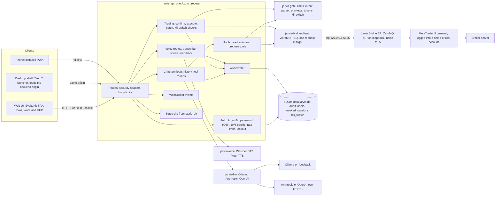
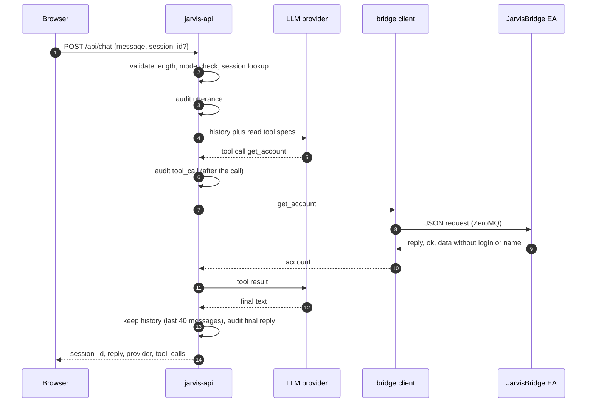
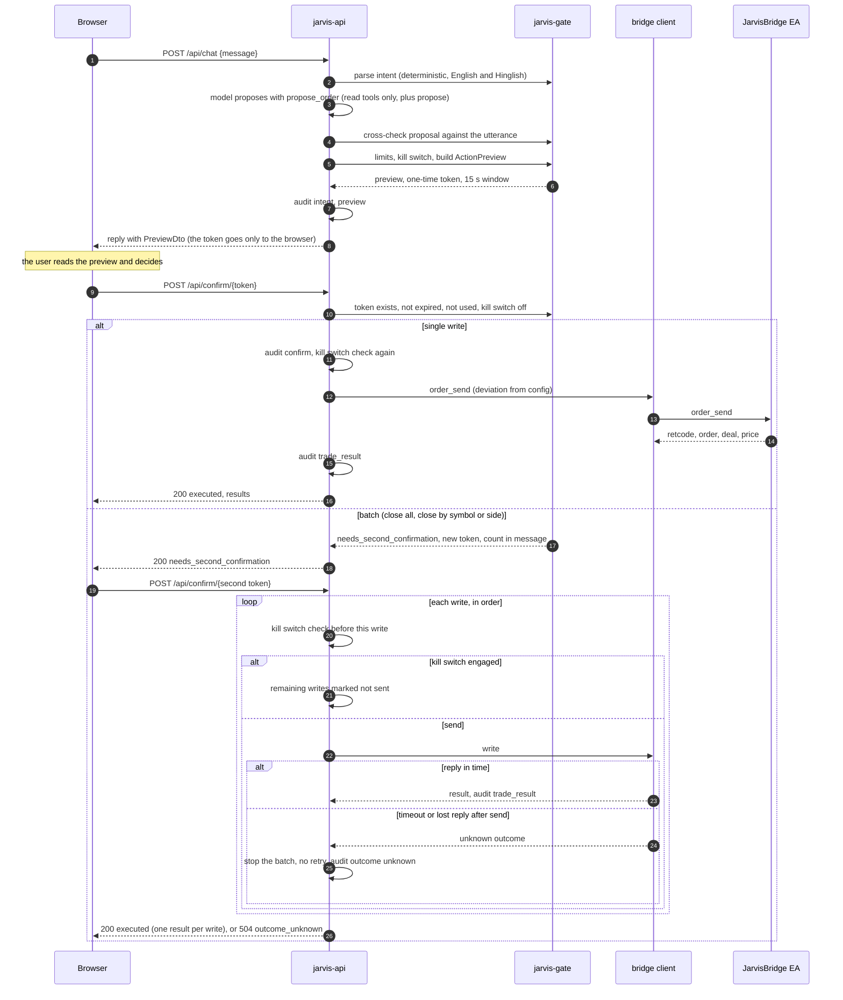
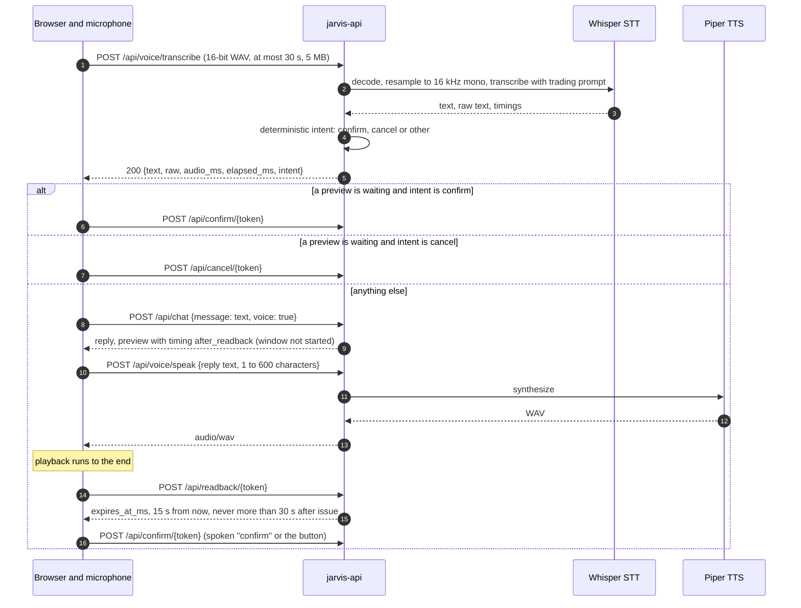

# Architecture

This page describes the whole system as it is built through Sprint 5: the components, how a request flows
through them, where each safety rule is enforced, what is stored where, and how things fail. The product
rules are in [SPEC.md](../SPEC.md). The wire contracts are in [api.md](api.md) (HTTP) and [protocol.md](protocol.md)
(EA bridge). Settings are in [configuration.md](configuration.md).

The central design choice: a language model can read data and **propose** trades, but only a deterministic
confirmation step, reached through a short-lived token, can send an order to MetaTrader 5.

## Components

Outside the runtime, GitHub Actions builds and checks the project (CI, security scans, OpenSSF Scorecard, the optional
Whisper build, and tagged releases). See "Build and release pipeline" below.

## Crates, modules and files

| Unit | Responsibility | Main files |
|---|---|---|
| `jarvis-bridge-client` (`crates/bridge-client`) | Wire types (`Command`, replies, DTOs, retcodes). `BridgeClient` is one actor: one request in flight, a timeout (default 3 s), a socket reset after a failure, and a reply-id check. Every message is signed with the shared bridge key (two frames, HMAC-SHA256) and every reply is verified (ADR-0016). The `mock` feature provides an in-process REP server, with the same authentication, and a standalone mock EA. | `src/protocol.rs`, `src/auth.rs`, `src/client.rs`, `src/mock.rs`, `src/mock_trade.rs`, `src/error.rs`; examples `bridge_cli.rs`, `mock_server.rs` |
| `jarvis-llm` (`crates/llm`) | `LlmProvider` trait with tool calling, `build_provider`, and the Ollama, Anthropic and OpenAI clients. Reads API keys from the variable named in config. | `src/lib.rs`, `src/types.rs`, `src/ollama.rs`, `src/anthropic.rs`, `src/openai.rs`, `src/util.rs` |
| `jarvis-gate` (`crates/gate`) | The action gate: limit checks, the deterministic intent parser (English and Hinglish), previews, one-time confirmation tokens with their stages and timing, and the kill switch. No I/O, so it is tested on its own. | `src/limits.rs`, `src/intent.rs`, `src/preview.rs`, `src/tokens.rs`, `src/killswitch.rs` |
| `jarvis-voice` (`crates/voice`) | WAV decoding, transcript clean-up and corrections, Whisper STT (feature `whisper`), Piper TTS as a child process. | `src/audio.rs`, `src/stt.rs`, `src/text.rs`, `src/tts.rs` |
| `jarvis-api` (`crates/api`) | The binary. Config and validation, HTTP and WebSocket routes, `AppState` and startup checks, the chat turn loop and read/propose tools, the trading service (confirm, execute, batch, kill switch), login and sessions, voice routes, events, security headers, static files, the SQLite audit log, the `user` CLI and the Windows service. | `src/config.rs`, `routes.rs`, `state.rs`, `serve.rs`, `symbols.rs`, `tools.rs`, `trading.rs`, `voice.rs`, `ws.rs`, `events.rs`, `security.rs`, `static_site.rs`, `ratelimit.rs`, `audit.rs`, `clock.rs`, `users.rs`, `cli.rs`, `service.rs`, `auth/{mod,http,store,crypto}.rs`; migrations `0001_audit.sql`, `0002_users.sql`, `0003_kill_switch.sql` |
| `JarvisBridge` EA (`mql5/`) | ZeroMQ REP socket on loopback, polled from `OnTimer` (20 ms, at most 10 requests per tick). Validates each request before doing anything. Read commands, plus five write commands that run only on request. | `Experts/JarvisMT/JarvisBridge.mq5`; `Include/Jarvis/{Json,Protocol,ReadHandlers,TradeHandlers}.mqh`; self-test `Scripts/JarvisMT/JarvisSelfTest.mq5` |
| Vendored mql-zmq | ZeroMQ binding for MQL5, with a local patch and its DLLs (checksums in `mql5/THIRD_PARTY.md`) | `Include/Zmq/`, `Include/Mql/`, `Libraries/*.dll` |
| `web` | SvelteKit single-page app (adapter-static, fallback `index.html`). Typed client for the HTTP contract, state stores, components (HUD, orb, confirm modal, kill switch, audit page, login), PWA service worker, mock mode. | `src/lib/api.ts`, `src/lib/state/*.svelte.ts`, `src/lib/components/*.svelte`, `src/routes/`, `src/service-worker/`, `static/manifest.webmanifest`; `vite.config.ts` |
| `apps/desktop` | Tauri 2 shell. A bundled launcher page asks for the backend URL, checks `/api/health`, then navigates to that origin. No trading logic. Not in the Cargo workspace. | `src-tauri/`, `ui/`, `src-tauri/tauri.conf.json` |
| `scripts/` | Install and compile the EA (SHA-256 checks), download voice models with pinned hashes, and run every local check. | `install-ea.ps1`, `compile-ea.ps1`, `fetch-models.ps1`, `check.ps1` |

Dependencies point one way. `jarvis-api` depends on the four library crates. The EA and the web app depend only on the wire contracts
(`docs/protocol.md`, `docs/api.md`). Library crates return typed errors. Only the binary uses `anyhow`.

## Request flow 1: a read question

Example: "what's my equity?" typed in the web UI.

The chat turn loop (the `run_turn` function in `crates/api/src`) allows at most five model rounds. After that it stops with a fixed reply.
A failed bridge call does not fail the HTTP request. It becomes a tool result that tells the model MT5 is unreachable, and the model
must say so instead of guessing. A failure of the LLM call itself becomes `502 llm_error`.

Symbols are resolved before any bridge call: alias lookup, cleanup, then the broker suffix (`crates/api/src/symbols.rs`).

## Request flow 2: propose, confirm, execute

Example: "buy 0.1 gold with SL 2300", with a batch variant "close all nasdaq longs".

Points that the code enforces:

- The LLM never gets a write tool. The tool set is a closed enum of read tools and `propose_*` tools
  (`crates/api/src/tools.rs`). Only the trading service calls the bridge's write commands, and only from the confirm path.
- A preview token is returned to the browser and never to the model. A token is one-time. It expires after `[trading] token_ttl_secs`
  (15 s by default). Engaging the kill switch revokes every live token at once.
- Batch actions use two stages, each with its own token and window. Cancelling either token cancels both (ADR-0008).
- Confirmation is rate limited per login session: 10 per minute.
- A write that is sent but gets no reply is never retried (ADR-0013). Earlier writes in the batch keep their results, and the
  response says how many completed.
- Single writes that MT5 rejects return `502 trade_failed` with the retcode. Batch failures are reported per write in `results`, with
  HTTP 200, so the UI must read `results`.

## Request flow 3: a voice turn

Read-back timing (ADR-0007): a voice preview does not start its 15-second window until the spoken read-back has finished, so a
listener has the full time to hear it. The window is capped at `voice_token_cap_secs` (30 s) from issue. Only one transcription runs
at a time, and a request that waits more than 5 s for its turn gets `429`.

Voice logs (`voice_stt`, `voice_tts`) hold text and sizes, never audio.

## Where each rule is enforced

The rules are the ten core rules of [SPEC.md](../SPEC.md). "Test" names the test area; tests live in `crates/*/src` (unit),
`crates/*/tests` and `crates/api/tests`.

| Rule | Enforced in | Notes |
|---|---|---|
| 1. The LLM can only read and propose | `crates/api/src/tools.rs` (closed `ReadTool` and `ProposeTool` enums, no write variant); `crates/api/src/trading.rs` (only the confirm path calls the write sink); EA `TradeHandlers.mqh` (writes only on a request) | Tests check that no write tool is offered to the model. |
| 2. A preview with a one-time 15-second token | `crates/gate/src/preview.rs` (`ActionPreview`), `crates/gate/src/tokens.rs` (`TokenStore::issue`, `confirm`, `cancel`), TTL from `[trading]` | Tokens are kept in memory. A restart invalidates them. |
| 3. Only `POST /api/confirm/{token}` sends a write | `crates/api/src/routes.rs` (route table), `crates/api/src/trading.rs` (`confirm` and `execute`) | Close and cancel routes create previews only. |
| 4. Batch actions need a second confirmation with the count | `crates/gate/src/tokens.rs` and `preview.rs` (stages `first` and `second`), `crates/api/src/trading.rs` | Message repeats the count. |
| 5. Limits checked before a preview is issued | `crates/gate/src/limits.rs` (validation and trading hours), `crates/gate/src/preview.rs::evaluate` (`max_lot`, `max_positions`, `max_daily_loss`, `allowed_symbols`) | Without a `[limits]` section nothing can be traded (`crates/api/src/config.rs::effective_limits`). |
| 6. Kill switch disables all writes instantly | `crates/gate/src/killswitch.rs` (process-wide flag); checked in `tokens.rs` (confirm), in `preview.rs::evaluate` (a refused preview), and in `trading.rs` before every single write; engaging revokes live tokens | The EA-side refusal (Algo Trading off in MT5) is a second, independent stop. |
| 7. DEMO by default; LIVE only when set; refuse DEMO on a real account | `crates/api/src/config.rs` (`Mode` defaults to demo), `crates/api/src/state.rs` (`startup_check`, `mode_mismatch`), `routes.rs` (`409 mode_mismatch` on chat); EA `InpAllowReal` in `TradeHandlers.mqh` | The web UI shows a LIVE banner when the server reports live mode. |
| 8. Account credentials stay in MT5 | `crates/bridge-client/src/protocol.rs` (the account type has no login, name or server fields); `crates/api/src/tools.rs` | Enforced by type, so the data cannot reach the model or the browser. |
| 9. Ambiguous intent: ask, never guess | `crates/gate/src/intent.rs` (`parse`, `cross_check`); unknown symbols are errors, not guesses (`symbols.rs`) | A proposal that contradicts the utterance is rejected. |
| 10. Every step is audited | `crates/api/src/audit.rs` (`record`), `migrations/0001_audit.sql` (append-only triggers); calls from `trading.rs`, `tools.rs`, `voice.rs`, `auth/` | Audit writes are best effort: a failed insert is logged at error level and does not fail the request. |
| Loopback only for the bridge and for binds without TLS and login | `crates/api/src/config.rs` (`validate_loopback_endpoint`, `bind_addr`); EA `EndpointIsLocalOnly` in `JarvisBridge.mq5` | Startup refuses a non-loopback bind unless TLS and login are both on. |
| Secrets stay out of files that might be committed | `crates/api/src/config.rs` (keys come from named environment variables); `.env` and `config/jarvis.toml` are gitignored | `JARVIS_JWT_SECRET` is read from the environment only. |

Other enforced controls:

- **Login:** `crates/api/src/auth/` (Argon2id hashing, TOTP with replay protection, JWT in an HttpOnly, SameSite=Strict cookie, revocation
  table, lockout after 10 failures from one client address for 15 minutes, a 2 s delay per attempt on an account that sees 50 failures from all
  addresses within 15 minutes, 5 login attempts per minute per client address, a signing secret that must hold at least 16 different byte values).
- **Transport and browser hardening:** `crates/api/src/security.rs` (CSP with hashes of the built inline scripts, HSTS when TLS is on,
  `nosniff`, `DENY` framing, `no-referrer`), `crates/api/src/serve.rs` (rustls), `crates/api/src/ws.rs` (Origin must match Host, 16 sockets).
- **Body size:** 64 KB for JSON routes, 5 MB for voice upload (`crates/api/src/routes.rs`).
- **Time, connection and request limits:** header read timeout (also the keep-alive idle limit), per-request timeouts (30 s, 200 s for chat, voice and
  confirm, none on the WebSocket) and a connection cap in `crates/api/src/serve.rs` and `routes.rs`; a per-session request budget for chat and voice
  transcription in `routes.rs` and `state.rs`.
- **Between preview and write:** `Trading::execute` takes a write lock, checks the kill switch, and runs the gate again for a new order
  (`Trading::recheck`) before the first bridge write; the bridge client serves its write lane before its read lane.

## Data stores

| Store | Location | Contents | Lifetime |
|---|---|---|---|
| SQLite `audit` | `data/jarvis.db` (WAL mode) | Every step of every turn, trade and login event. `id, ts, session_id, kind, payload` (JSON text). | Append-only. Insert triggers only. Never trimmed by the server. |
| SQLite `users` | `data/jarvis.db` | Username (case-insensitive), Argon2id PHC hash, TOTP secret encrypted with ChaCha20-Poly1305 (key from `JARVIS_JWT_SECRET` through HKDF-SHA256), last used TOTP step, failed attempts, lock time, `tokens_valid_after`. | Managed with the `user` commands. |
| SQLite `revoked_sessions` | `data/jarvis.db` | `jti` of logged-out sessions, kept until the token would have expired. | Pruned by expiry. |
| SQLite `kill_switch` | `data/jarvis.db` | One row: whether the kill switch is engaged, why, and when it changed. Read at startup. | Rewritten on every engage and release. A switch that is engaged stays engaged across restarts; an unreadable row engages it. |
| In memory | Process | Chat sessions (at most 100, history capped at 40 messages), confirmation tokens, rate limit counters, open WebSockets. | Lost on restart. |
| Files | `config/jarvis.toml`, `.env` | Settings and secrets. | Edited by hand. |
| Files | `models/` | Whisper and Piper models, pinned and hash-checked by `fetch-models.ps1`. | Replace by re-running the script. |
| Files | `logs/` | Daily log of the service (`jarvis-api.log.<date>`). Console runs log to the console. | Not rotated by count. Delete old files yourself. |
| Files | `web/build/` | The built UI served from `static_dir`. | Rebuild with `pnpm -C web build`, then restart the server. |
| MT5 | The terminal's own data | Account, positions, orders, history. Jarvis reads and writes through the EA only. | MT5's own store. |

## Ports

| Port | Used by | Bound to | Notes |
|---|---|---|---|
| 8787 | `jarvis-api` HTTP, WebSocket, static site | `server.bind` (loopback by default) | Off loopback only with TLS and login. |
| 5555 | `JarvisBridge` EA (ZeroMQ REP) | `127.0.0.1` only | `bridge.endpoint` and `InpEndpoint` must match. Only a holder of the shared `bridge.key` is answered. |
| 11434 | Ollama | Loopback | Used by the `local` provider. |
| 5173 | Vite dev server | Local | Proxies `/api` (including WebSocket) to 8787. |
| 443 | Optional reverse proxy | Public | Terminates TLS and forwards to a loopback `jarvis-api`. |

## Failure modes

| Failure | What happens | What the user sees | Recovery |
|---|---|---|---|
| EA not attached, or MT5 closed at start | The server starts and logs a warning. Status shows `connected: false`. | Chat says MT5 is not reachable. Writes fail before anything is sent. | Attach the EA. The next request reconnects. |
| Bridge stops answering during reads | The request times out after 3 s, and the socket is reset. | `bridge_unavailable` for the HTTP call, or a tool error in chat. | Check the EA log. Re-attach if needed. |
| Bridge stops answering during a write | The write may or may not have run. No retry. Batches stop at that write. | `504 outcome_unknown`, with how many writes completed and that the rest were not sent. | Check MT5, then decide. See the [runbook](runbook.md). |
| Bridge refuses before sending (connect refused, send failed) | Treated as not sent. The write is reported as an error. | `trade_failed` (single) or an error entry in `results` (batch), and the batch continues. | Fix the bridge, then make a new preview. |
| Kill switch engaged mid-batch | The remaining writes are not sent. | `200 executed` with `"aborted": "kill_switch"` and "not sent" entries. | Check MT5 for the writes that did run. |
| Mode mismatch (real account while `mode = "demo"`) | Startup refuses. While running, chat returns `409`. | `mode_mismatch`. | Log MT5 into the demo account. |
| LLM provider down or key missing | Chat fails for that provider. Trading does not use the LLM, so existing previews still confirm. | `502 llm_error`, or the provider shows `available: false`. | Start Ollama, or fix the key. Switch provider in the UI. |
| Voice engine missing | Only that half is off. The typed flow still works. | `503 voice_unavailable`. | Fix the model path or build with `whisper`. |
| Process restart | Chat sessions, previews and tokens are lost. Users, the audit log, revoked sessions and the kill switch survive (an engaged switch stays engaged). | Previews expire. The UI asks again. | Ask again. Release the kill switch with a fresh authenticator code when you want to trade again. |
| Database unavailable at start | Startup fails (migrations and user checks need it). | Process exits with an error. | Fix the file and its permissions, then start again. |
| Audit insert fails at runtime | Logged at error level. The request continues. | Nothing visible. | Investigate the log. Audit gaps are a defect to fix at once. |
| TLS certificate missing or unreadable at start | Startup fails with the file names. | Process exits. | Fix the paths. Restart after every renewal. |
| Secret changed or too short | Startup refuses while login is on. Old TOTP secrets cannot be read after a change. | Logins fail with the message that the stored secret cannot be decrypted. | Reset TOTP for each user (see the [runbook](runbook.md)). |

## Build and release pipeline

| Workflow | When | What it checks or builds |
|---|---|---|
| `ci.yml` (CI) | Pushes to `main`, pull requests, manual | Rust: format, clippy with `-D warnings`, tests, on Windows and Ubuntu. Web: check, unit tests, build, Playwright end-to-end. Desktop shell build. Markdown relative links (offline). Workflow lint with actionlint. A summary job. |
| `security.yml` (Security) | Pushes, pull requests, weekly | cargo-deny (advisories, bans, licences, sources), cargo-audit, pnpm audit, gitleaks on the full history, semgrep (SARIF), CodeQL. |
| `scorecard.yml` (OpenSSF Scorecard) | Pushes to `main`, weekly, branch protection events | Publishes the Scorecard analysis. |
| `whisper.yml` (Whisper build) | Pushes, pull requests, weekly, manual | Clippy and tests for `jarvis-voice` with `--features whisper` on Windows, after installing CMake and LLVM. |
| `release.yml` (Release) | Tags matching `v*` | Builds `jarvis-api` (standard, and a whisper variant that does not block the release), the web build, the EA sources, and the desktop installer. Writes `SHA256SUMS`, attaches a build provenance attestation, and creates the GitHub release with notes from `CHANGELOG.md`. |

Locally, `pwsh scripts/check.ps1` runs the same kinds of checks (format, clippy, tests, whisper, desktop, web, security tools).

## Changing the system

This document describes the system as it is built. The sprint plan and its work split are in
[tasks/plan-sprints-2-5.md](../tasks/plan-sprints-2-5.md). Changes to the safety path (gate, tokens, kill switch, auth, EA write path) need tests and an
ADR, as [CONTRIBUTING.md](../CONTRIBUTING.md) describes. The decision records are in [docs/adr/](adr/README.md).
